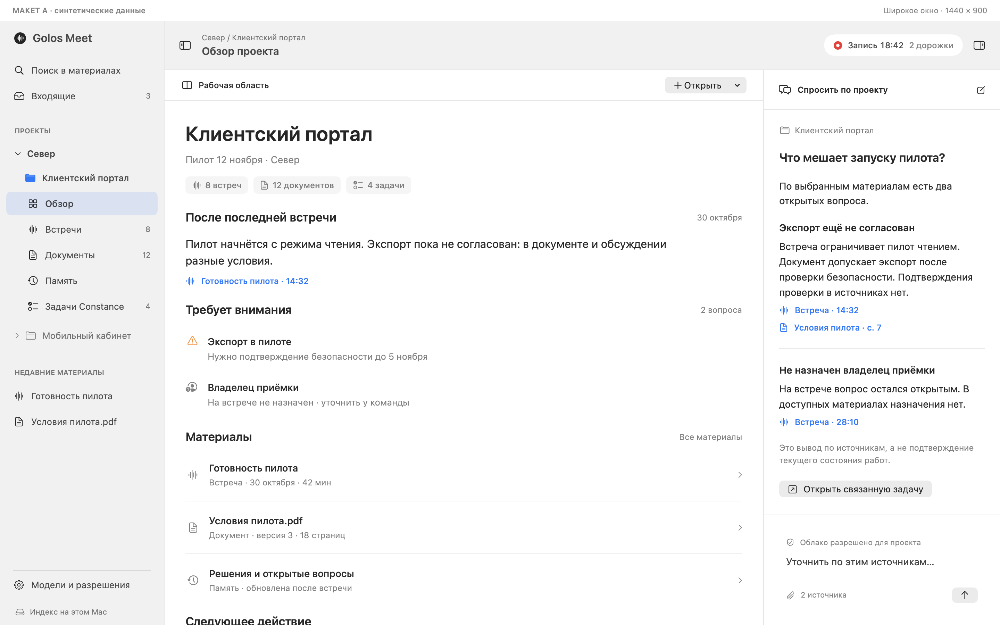
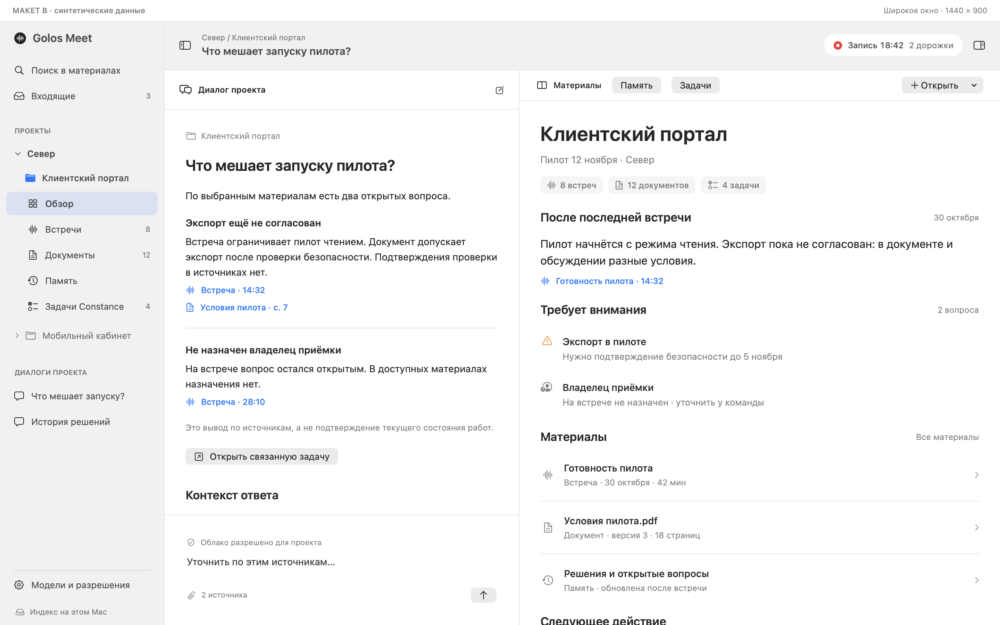

# Макеты рабочей области — #18

**Для обсуждения, не согласованы. Все данные синтетические.**

[Исследование и первичные источники](RESEARCH.md) · [Brief, поведение и вопросы выбора](BRIEF.md)

## Два варианта

**A — проект в центре, чат справа.** Предварительная рекомендация для обзора проекта и проверки источников. Риск: при длительном диалоге чат теснее.



**B — чат в центре, материалы справа.** Равноправный кандидат для работы от вопроса. Риск: чтение большого документа требует расширения панели.



## Сопоставимые экраны

Оба варианта используют один проект, одну встречу, один документ и один ответ. Ширина основного viewport 1440×900 pt; PNG экспортированы в Retina 2×.

| Сценарий | A | B |
|---|---|---|
| Обзор проекта | [Открыть](renders/A-overview-wide-light.png) | [Открыть](renders/B-overview-wide-light.png) |
| Локальный поиск с источниками | [Открыть](renders/A-search-wide-light.png) | [Открыть](renders/B-search-wide-light.png) |
| Встреча / расшифровка | [Открыть](renders/A-meeting-wide-light.png) | [Открыть](renders/B-meeting-wide-light.png) |
| Документ / страница 7 | [Открыть](renders/A-document-wide-light.png) | [Открыть](renders/B-document-wide-light.png) |
| Память / конфликт версий | [Открыть](renders/A-memory-wide-light.png) | [Открыть](renders/B-memory-wide-light.png) |
| Задачи / подзадачи Constance | [Открыть](renders/A-tasks-wide-light.png) | [Открыть](renders/B-tasks-wide-light.png) |
| Предлагаемый редактор задачи | [Открыть](renders/A-taskEdit-wide-light.png) | [Открыть](renders/B-taskEdit-wide-light.png) |
| Fullscreen 1920×1080, тёмная тема | [Открыть](renders/A-meeting-fullscreen-dark.png) | [Открыть](renders/B-meeting-fullscreen-dark.png) |
| Непрозрачная версия, без движения | [Открыть](renders/A-overview-reduced.png) | [Открыть](renders/B-overview-reduced.png) |

Общие экраны: [empty/loading/error/permissions/conflict/offline](renders/shared-states.png), [запись и menu bar](renders/shared-recording.png), [настройки и разрешения](renders/shared-settings.png).

## Повторение

На Apple Silicon с Xcode 26+ (проверено Xcode 27.1 / SDK 27.0):

```sh
research/ui18/native/render.sh
```

Скрипт собирает отдельный host в `.build/ui18-native/GolosUI18Research.app`, bundle `com.golos.research.ui18.synthetic`, и экспортирует PNG. Он не собирает и не запускает production app. NSApplication используется только для offscreen NSHostingView; серверов, аудиозахвата, запросов разрешений, Keychain, UserDefaults и сетевых вызовов в host нет. Временный каталог уникален и удаляется при завершении. Скрипт не требует моделей или данных.

Обычный запуск host без `--export` только печатает usage. Стекло в экспорте схематично: offscreen capture не доказывает оптику Liquid Glass. Элементы интерфейса показывают композицию и будущие действия, живые интеграции отсутствуют. Реальные accessibility/resize/fullscreen-переходы/производительность ещё требуют интерактивного прототипа после выбора.

## Нужно выбрать

1. A — проект/материал или B — диалог как постоянный центр?
2. Контекстная панель открыта по умолчанию или появляется по запросу с запоминанием?
3. Для Constance достаточно списка и редактора рядом, или нужна закрепляемая панель задач во время встречи?

До ответов и согласования этот каталог не является указанием запускать production-редизайн #19.
