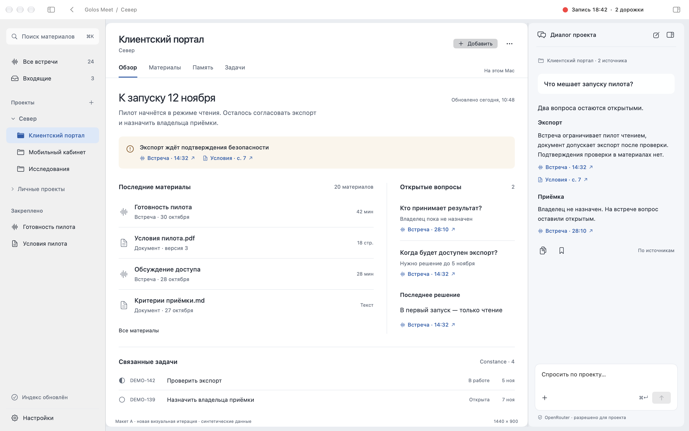
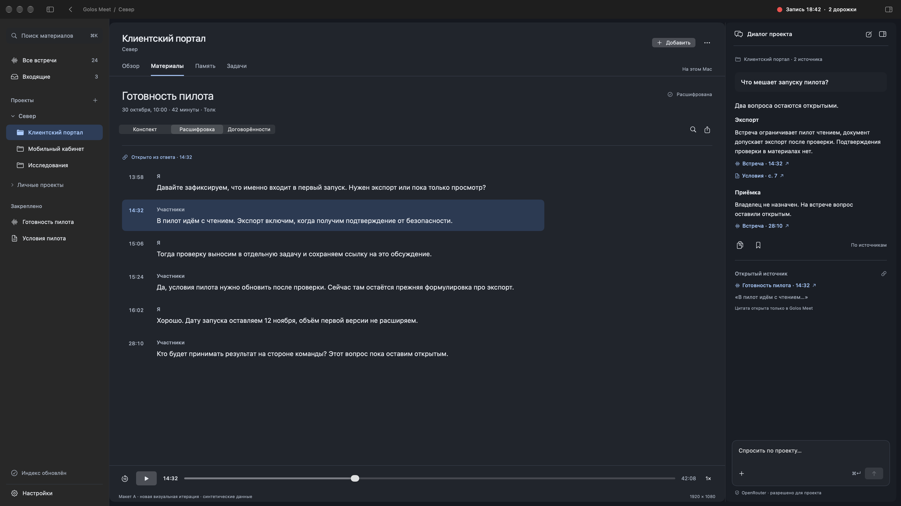
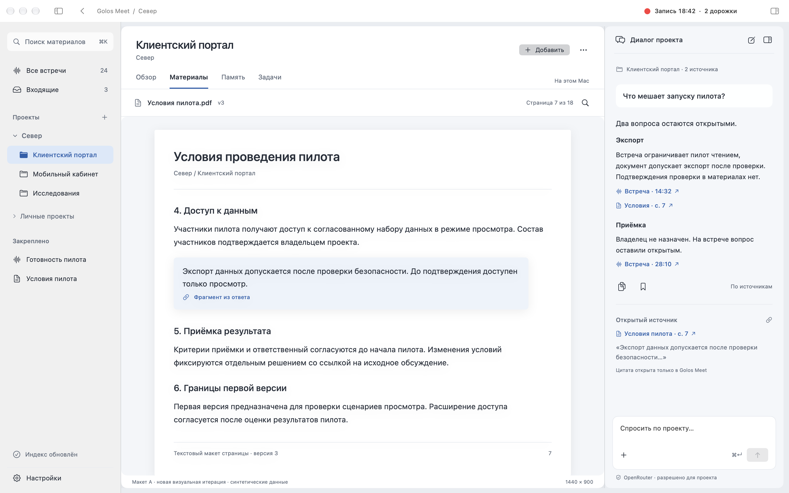

# Golos Meet — новая внешность выбранного варианта A

**Архитектура A выбрана пользователем. Предыдущее оформление отклонено. Визуальная итерация v2 — предложение для просмотра, ещё не согласована.** Production UI не изменялся, #19 не запущен.

[Brief и правила поведения](BRIEF.md) · [Исследование и первичные источники](RESEARCH.md) · [Проверки и пределы](CHECKS.md)

## Обзор проекта

Нативная рамка/toolbar, компактное дерево слева, единая поверхность проекта, материалы и открытые вопросы рядом, постоянный диалог справа.



## Встреча и источник

Расшифровка с выбранным фрагментом, нативный segmented control и плеер, контекст открытой цитаты рядом с ответом.



## Документ

Отдельная читаемая страница, номер/версия, выделенный фрагмент. Это текстовый макет PDF-страницы, не интеграция PDF viewer.



## Все семь PNG

Viewport указан в pt, PNG — Retina 2×. Fullscreen здесь означает композицию, не проверенный системный переход.

| Экран | 1440×900 light | 1920×1080 dark |
|---|---|---|
| Обзор проекта | [Открыть](renders/A2-overview-wide-light.png) | [Открыть](renders/A2-overview-fullscreen-dark.png) |
| Встреча / расшифровка | [Открыть](renders/A2-meeting-wide-light.png) | [Открыть](renders/A2-meeting-fullscreen-dark.png) |
| Документ / источник | [Открыть](renders/A2-document-wide-light.png) | [Открыть](renders/A2-document-fullscreen-dark.png) |

[Встреча: непрозрачная навигация, без движения](renders/A2-meeting-reduced.png).

Первоначальные A/B сохранены в истории Git до `db39eeaf066316425022bf08f4cb037648bc3104`. Они больше не выставлены как актуальные или одобренные экраны.

## Повторение

На Apple Silicon с Xcode 26+ (проверено Xcode 27.1 / SDK 27.0):

```sh
research/ui18/native/render.sh
```

Скрипт собирает отдельный native host в `.build/ui18-native/GolosUI18Research.app`, bundle `com.golos.research.ui18.synthetic`, и экспортирует семь PNG. Снимок собственной offscreen рамки NSWindow включает настоящий NSToolbar; внутри — NSHostingView. В host нет production AppDelegate, импорта Golos, чтения библиотеки/Keychain, микрофона, моделей, recovery или сети. Окна не выводятся на рабочий стол. Без `--export` host только печатает usage. Происхождение, размеры и hashes — `renders/manifest.json`.

PNG не доказывают optical Liquid Glass, resize/restore, fullscreen/Spaces, VoiceOver и производительность. AppKit window в экспорте неактивен. Controls без описанной локальной навигации — визуальные заглушки; отправка запроса не работает. Actual OS accessibility settings не менялись. Минимальная macOS остаётся 14.4, запуск на этой ОС не проверен.

Constance: только выбранные видимые поля задачи/подзадач и ссылка на встречу; без transcript, документов и автоцитат. Цитаты в диалоге/документе — только локальная навигация Golos Meet.

Следующий шаг — просмотр и согласование внешности A. Самопроверка автора не заменяет независимого ревью обновлённого SHA; старый вердикт на новые экраны не распространяется.
